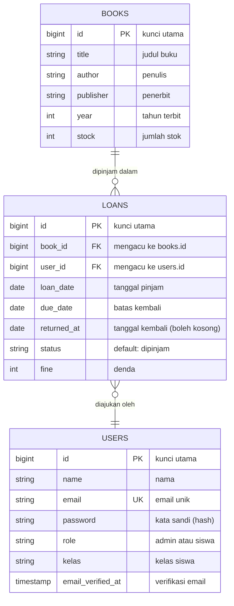

# Aplikasi Peminjaman Buku

Aplikasi web untuk membantu perpustakaan sekolah mencatat buku dan peminjamannya. Dibuat dengan Laravel, dan halaman pengelolaannya memakai Filament 4. Proyek ini saya kerjakan sebagai tugas UKK 2026.

Pembuat: Andi Alfatih Ghaisan Aththobarani

---

## Tentang Aplikasi

Selama ini peminjaman buku di sekolah sering dicatat manual di buku tulis. Akibatnya susah mengecek siapa yang belum mengembalikan buku, berapa stok yang tersisa, dan siapa yang kena denda. Aplikasi ini dibuat untuk merapikan semua itu: data buku, data siswa, dan riwayat peminjaman disimpan di satu database sehingga lebih mudah dicari dan dikelola.

Ada dua jenis pengguna, dibedakan lewat kolom `role` di tabel `users`:

- **admin**: mengelola data buku, pengguna, dan peminjaman.
- **siswa** (bawaan): orang yang meminjam buku, punya data `kelas`.

### Alur Peminjaman

1. Saat seorang siswa meminjam buku, data baru dibuat di tabel `loans` berisi `loan_date`, `due_date`, dan `status` awal `dipinjam`.
2. Ketika buku dikembalikan, kolom `returned_at` diisi tanggal pengembalian dan `status` diperbarui.
3. Kalau pengembalian melewati `due_date`, jumlah dendanya dicatat di kolom `fine`.

## Fitur

- **Buku**: judul, penulis, penerbit, tahun terbit, dan stok.
- **Peminjaman**: tanggal pinjam, batas kembali, tanggal kembali, status, dan denda.
- **Pengguna**: akun lengkap dengan peran dan kelas.
- **Panel admin Filament**: tampilan tabel, form input, pencarian, dan filter.

## Teknologi yang Dipakai

- PHP dan Laravel
- Filament 4
- MySQL (lewat XAMPP)
- Composer
- Git dan GitHub

## ERD

Tabel `loans` berada di tengah sebagai penghubung. Setiap baris peminjaman mencatat satu siswa dan satu buku, sedangkan siswa maupun buku bisa muncul di banyak peminjaman (relasi one-to-many).



Keterangan relasi:

- `books` ke `loans`: satu buku bisa dipinjam berkali-kali (`loans.book_id`).
- `users` ke `loans`: satu pengguna bisa punya banyak riwayat peminjaman (`loans.user_id`).

## Dokumentasi Model

### Book (`app/Models/Book.php`)

| Elemen | Jenis | Keterangan |
|--------|-------|------------|
| `$fillable` | properti | Kolom yang boleh diisi sekaligus: `title`, `author`, `publisher`, `year`, `stock`. |
| `loans()` | relasi hasMany | Mengambil semua peminjaman untuk buku ini. Contoh: `$book->loans`. |

### Loan (`app/Models/Loan.php`)

| Elemen | Jenis | Keterangan |
|--------|-------|------------|
| `$fillable` | properti | `user_id`, `book_id`, `loan_date`, `due_date`, `returned_at`, `status`, `fine`. |
| `$casts` | properti | `loan_date`, `due_date`, dan `returned_at` otomatis dibaca sebagai tanggal (Carbon). |
| `user()` | relasi belongsTo | Mengambil peminjamnya lewat `user_id`. Contoh: `$loan->user->name`. |
| `book()` | relasi belongsTo | Mengambil buku yang dipinjam lewat `book_id`. Contoh: `$loan->book->title`. |

### User (`app/Models/User.php`)

| Elemen | Jenis | Keterangan |
|--------|-------|------------|
| `$fillable` | properti | `name`, `email`, `password`, `role`, `kelas`. |
| `$hidden` | properti | `password` dan `remember_token` disembunyikan saat model diubah ke array atau JSON. |
| `casts()` | fungsi | `email_verified_at` jadi datetime, `password` otomatis di-hash. |
| `isAdmin()` | fungsi | Mengembalikan `true` kalau `role` bernilai `admin`, selain itu `false`. |
| `loans()` | relasi hasMany | Mengambil riwayat peminjaman milik pengguna. Contoh: `$user->loans`. |

## Route

| Method | URL | Keterangan |
|--------|-----|------------|
| GET | `/` | Menampilkan halaman awal (`welcome`) |
| GET | `/admin` | Masuk ke panel admin Filament |

## Debugging

Berikut beberapa masalah yang saya temui selama pengerjaan, penyebabnya, dan cara memperbaikinya.

### 1. Relasi hanya ada di satu sisi

Waktu memanggil `$book->loans` atau `$user->loans`, muncul error karena relasinya tidak ditemukan. Ternyata yang punya relasi baru model `Loan` (belongsTo), sedangkan sisi sebaliknya belum saya tulis. Solusinya menambahkan `hasMany` di model `Book` dan `User`.

```php
use Illuminate\Database\Eloquent\Relations\HasMany;

public function loans(): HasMany
{
    return $this->hasMany(Loan::class);
}
```

### 2. Nilai status gampang salah ketik

Pernah data peminjaman tidak muncul saat difilter, padahal datanya ada. Penyebabnya `status` ditulis sebagai teks bebas, jadi salah satu huruf saja sudah membuat hasilnya tidak cocok. Supaya konsisten, nilai status disimpan sebagai konstanta dan dipakai di semua tempat.

```php
// app/Models/Loan.php
public const STATUS_DIPINJAM = 'dipinjam';
public const STATUS_KEMBALI  = 'dikembalikan';

// contoh pemakaian
Loan::where('status', Loan::STATUS_DIPINJAM)->get();
```

### 3. Stok tidak ikut berubah

Setelah buku dipinjam, stok tidak berkurang, dan kalau tidak dijaga bisa jadi minus. Penyebabnya belum ada proses yang mengubah `stock` saat pinjam dan kembali. Cara yang aman adalah memeriksa stok, mengurangi stok, dan menyimpan peminjaman dalam satu transaksi database.

```php
use Illuminate\Support\Facades\DB;

DB::transaction(function () use ($book, $user) {
    if ($book->stock < 1) {
        abort(422, 'Stok buku habis');
    }

    $book->decrement('stock');

    Loan::create([
        'user_id'   => $user->id,
        'book_id'   => $book->id,
        'loan_date' => now(),
        'due_date'  => now()->addDays(7),
        'status'    => Loan::STATUS_DIPINJAM,
    ]);
});
```

### Error yang Sering Muncul

| Pesan error | Penyebab | Solusi |
|-------------|----------|--------|
| `SQLSTATE[HY000] [2002] Connection refused` | MySQL belum menyala | Nyalakan MySQL di XAMPP Control Panel, lalu cek `DB_HOST` dan `DB_PORT` |
| `SQLSTATE[HY000] [1049] Unknown database` | Database belum dibuat atau namanya beda | Buat database di phpMyAdmin dan samakan dengan `DB_DATABASE` |
| `SQLSTATE[HY000] [1045] Access denied` | Username atau password database salah | Di XAMPP bawaan: `DB_USERNAME=root` dan `DB_PASSWORD=` (kosong) |
| `Failed to open the referenced table` | Migration `loans` jalan sebelum `users` atau `books` | Pastikan timestamp file migration `loans` paling akhir, lalu `php artisan migrate:fresh` |
| `SQLSTATE[23000] Integrity constraint violation` | `user_id` atau `book_id` tidak ada di tabel induk | Isi data pengguna dan buku dulu sebelum membuat peminjaman |
| `MassAssignmentException` | Kolom belum masuk `$fillable` | Tambahkan kolom ke `$fillable` |
| `No application encryption key has been specified` | `APP_KEY` masih kosong | Jalankan `php artisan key:generate` |
| `Class "App\Models\Loan" not found` | Namespace atau nama file tidak cocok | Periksa keduanya, lalu jalankan `composer dump-autoload` |
| `404 Not Found` | Route belum terdaftar atau salah ketik | Cek dengan `php artisan route:list` |
| Perubahan `.env` tidak terbaca | Konfigurasi masih tersimpan di cache | Jalankan `php artisan config:clear` |
| Tampilan Filament tidak berubah | Cache lama | Jalankan `php artisan optimize:clear` |

### Cara Melacak Bug

| Tujuan | Cara |
|--------|------|
| Melihat isi variabel lalu menghentikan program | `dd($loan);` |
| Melihat isi variabel tanpa menghentikan program | `dump($request->all());` |
| Mencatat ke file log | `Log::info('data pinjam', $data);` lalu buka `storage/logs/laravel.log` |
| Melihat daftar route | `php artisan route:list` |
| Melihat status migration | `php artisan migrate:status` |
| Mencoba model langsung | `php artisan tinker`, lalu `Loan::with('user','book')->first();` |
| Menampilkan pesan error lengkap | Atur `APP_DEBUG=true` di `.env` (hanya saat pengembangan) |

## Cara Instalasi

1. Clone repository

   ```bash
   git clone https://github.com/gesannn/UKK-2026-Andi-Alfatih-Ghaisan-Peminjaman-Buku.git
   cd UKK-2026-Andi-Alfatih-Ghaisan-Peminjaman-Buku
   ```

2. Install dependency

   ```bash
   composer install
   ```

3. Salin file environment dan buat key aplikasi

   ```bash
   cp .env.example .env
   php artisan key:generate
   ```

4. Buat database kosong (misalnya `peminjaman_buku`) di phpMyAdmin, lalu sesuaikan file `.env`

   ```env
   DB_CONNECTION=mysql
   DB_HOST=127.0.0.1
   DB_PORT=3306
   DB_DATABASE=peminjaman_buku
   DB_USERNAME=root
   DB_PASSWORD=
   ```

5. Jalankan migration

   ```bash
   php artisan migrate
   ```

6. Buat akun untuk masuk ke panel admin

   ```bash
   php artisan make:filament-user
   ```

   Setelah itu pastikan kolom `role` pada akun tersebut bernilai `admin`.

7. Jalankan aplikasi

   ```bash
   php artisan serve
   ```

   Halaman awal ada di http://127.0.0.1:8000 dan panel admin di http://127.0.0.1:8000/admin.

## Database

Struktur tabel dibuat lewat migration, jadi cukup jalankan `php artisan migrate`. Perlu diingat bahwa migration `loans` harus berjalan paling akhir karena tabel ini punya foreign key ke `users` dan `books`.

## Laporan Evaluasi

### Tujuan

Membuat aplikasi berbasis Laravel yang membantu perpustakaan sekolah mencatat data buku dan peminjaman dengan lebih rapi.

### Hasil yang Dicapai

- Merancang tabel `users`, `books`, dan `loans` beserta ERD (relasi one-to-many).
- Membuat migration dan model `Book`, `Loan`, dan `User` lengkap dengan relasinya.
- Membedakan peran pengguna lewat kolom `role` (`admin` dan `siswa`).
- Menyiapkan panel admin dengan Filament 4.
- Menulis dokumentasi program dan menyimpan proyek di GitHub.

### Kendala

- Push ke GitHub sempat gagal dengan pesan `Repository not found` dan `rejected`. Masalah ini selesai setelah alamat remote diperbaiki dan `git pull --rebase` dijalankan.
- Urutan migration harus diatur supaya tabel `loans` dibuat setelah `users` dan `books`.

### Kekurangan

- Stok belum otomatis berubah saat buku dipinjam atau dikembalikan.
- Denda belum dihitung otomatis.
- Nilai `status` masih berupa teks biasa, belum memakai konstanta atau enum.
- Belum ada pengujian fitur.

### Rencana Perbaikan

1. Hubungkan stok dengan peminjaman memakai `DB::transaction()`.
2. Hitung denda otomatis dari jumlah hari keterlambatan.
3. Ganti nilai `status` dengan konstanta atau enum.
4. Batasi fitur tertentu agar hanya bisa diakses admin lewat `isAdmin()`.
5. Tambahkan pengujian untuk fitur utama.

### Kesimpulan

Fondasi aplikasi sudah selesai, yaitu struktur database, model, panel admin, dan dokumentasi. Langkah berikutnya adalah mengotomatiskan stok dan denda supaya aplikasi benar-benar siap dipakai sehari-hari.

## Lisensi

Proyek ini menggunakan lisensi [MIT](https://opensource.org/licenses/MIT).
