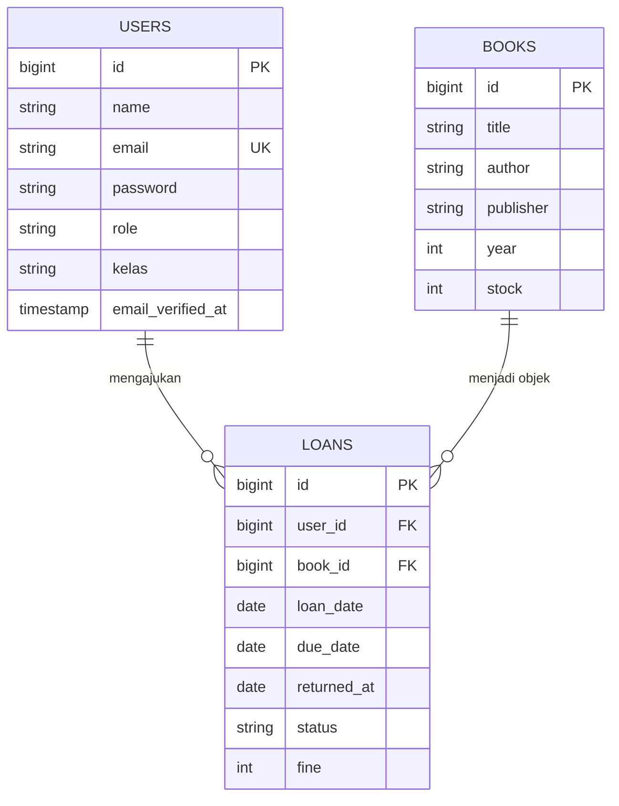

#  Sistem Informasi Peminjaman Buku

Aplikasi web berbasis **Laravel** dengan panel admin **Filament 4** untuk mengelola koleksi buku dan transaksi peminjaman di perpustakaan sekolah.

> Proyek UKK 2026 — **Andi Alfatih Ghaisan Aththobarani**

---

##  Gambaran Umum

Sistem ini menyimpan tiga jenis data utama: buku, pengguna, dan peminjaman. Pengguna dibagi menjadi dua peran lewat kolom `role` pada tabel `users`:

| Peran | Tugas |
|-------|-------|
| `admin` | Mengatur data buku, pengguna, dan seluruh transaksi peminjaman |
| `siswa` (bawaan) | Peminjam buku; memiliki data `kelas` |

### Tahapan Peminjaman

1. Peminjaman dicatat untuk seorang siswa. Sistem membuat baris baru di tabel `loans` berisi `loan_date`, `due_date`, dan `status` awal `dipinjam`.
2. Ketika buku diserahkan kembali, kolom `returned_at` diisi dan `status` diubah.
3. Jika tanggal kembali melewati `due_date`, besar denda dicatat di kolom `fine`.

##  Fitur

- **Buku** — judul, penulis, penerbit, tahun terbit, dan stok.
- **Peminjaman** — tanggal pinjam, tenggat, tanggal kembali, status, dan denda.
- **Pengguna** — akun dengan peran dan kelas.
- **Panel Admin Filament** — daftar data, form input, pencarian, dan filter.

##  Teknologi

- PHP dan Laravel
- Filament 4 (panel admin)
- MySQL melalui XAMPP
- Composer
- Git dan GitHub

##  ERD (Entity Relationship Diagram)



##  Dokumentasi Model

### `Book` — `app/Models/Book.php`

| Elemen | Jenis | Penjelasan |
|--------|-------|------------|
| `$fillable` | Properti | Kolom yang dapat diisi sekaligus: `title`, `author`, `publisher`, `year`, `stock`. |
| `loans()` | Relasi `HasMany` | Mengambil semua peminjaman untuk buku tersebut. Contoh: `$book->loans`. |

### `Loan` — `app/Models/Loan.php`

| Elemen | Jenis | Penjelasan |
|--------|-------|------------|
| `$fillable` | Properti | `user_id`, `book_id`, `loan_date`, `due_date`, `returned_at`, `status`, `fine`. |
| `$casts` | Properti | Kolom `loan_date`, `due_date`, dan `returned_at` dibaca sebagai objek tanggal (Carbon). |
| `user()` | Relasi `BelongsTo` | Mengambil peminjam lewat `user_id`. Contoh: `$loan->user->name`. |
| `book()` | Relasi `BelongsTo` | Mengambil buku lewat `book_id`. Contoh: `$loan->book->title`. |

### `User` — `app/Models/User.php`

| Elemen | Jenis | Penjelasan |
|--------|-------|------------|
| `$fillable` | Properti | `name`, `email`, `password`, `role`, `kelas`. |
| `$hidden` | Properti | `password` dan `remember_token` tidak ikut tampil ketika model dikonversi ke array/JSON. |
| `casts()` | Fungsi | `email_verified_at` menjadi datetime dan `password` di-hash otomatis. |
| `isAdmin()` | Fungsi → `bool` | Bernilai `true` bila `role` sama dengan `admin`. |
| `loans()` | Relasi `HasMany` | Mengambil riwayat peminjaman milik pengguna. Contoh: `$user->loans`. |

##  Daftar Route

| Method | URL | Keterangan |
|--------|-----|------------|
| GET | `/` | Menampilkan halaman awal (`welcome`) |
| GET | `/admin` | Masuk ke panel admin Filament |

##  Debugging

### Masalah yang Pernah Ditemui dan Solusinya

**1. Relasi tidak lengkap di satu sisi**
- *Gejala:* memanggil `$book->loans` atau `$user->loans` menimbulkan error relasi tidak ditemukan.
- *Penyebab:* relasi `belongsTo` hanya ada di `Loan`, sedangkan sisi lawannya belum ditulis.
- *Solusi:* tambahkan `hasMany` pada model `Book` dan `User`.

```php
use Illuminate\Database\Eloquent\Relations\HasMany;

public function loans(): HasMany
{
    return $this->hasMany(Loan::class);
}
```

**2. Nilai `status` tidak konsisten**
- *Gejala:* filter status tidak menemukan data meski datanya ada.
- *Penyebab:* `status` berupa teks bebas sehingga rawan salah ketik.
- *Solusi:* simpan nilai status sebagai konstanta lalu pakai di semua tempat.

```php
// app/Models/Loan.php
public const STATUS_DIPINJAM = 'dipinjam';
public const STATUS_KEMBALI  = 'dikembalikan';

// contoh pemakaian
Loan::where('status', Loan::STATUS_DIPINJAM)->get();
```

**3. Stok tidak mengikuti transaksi**
- *Gejala:* stok tetap atau bahkan menjadi minus setelah buku dipinjam.
- *Penyebab:* belum ada proses yang mengubah `stock` saat pinjam dan kembali.
- *Solusi:* periksa stok, kurangi stok, dan simpan peminjaman dalam satu transaksi database.

```php
use Illuminate\Support\Facades\DB;

DB::transaction(function () use ($book, $user) {
    if ($book->stock < 1) {
        abort(422, 'Stok buku habis');
    }

    $book->decrement('stock');

    Loan::create([
        'user_id'   => $user->id,
        'book_id'   => $book->id,
        'loan_date' => now(),
        'due_date'  => now()->addDays(7),
        'status'    => Loan::STATUS_DIPINJAM,
    ]);
});
```

### Error yang Sering Muncul

| Pesan Error | Penyebab | Cara Mengatasi |
|-------------|----------|----------------|
| `SQLSTATE[HY000] [2002] Connection refused` | MySQL belum aktif | Nyalakan MySQL di XAMPP Control Panel, lalu cek `DB_HOST` dan `DB_PORT` |
| `SQLSTATE[HY000] [1049] Unknown database` | Database belum dibuat atau namanya berbeda | Buat database di phpMyAdmin dan samakan dengan `DB_DATABASE` |
| `SQLSTATE[HY000] [1045] Access denied` | Username/password database salah | Pada XAMPP bawaan: `DB_USERNAME=root`, `DB_PASSWORD=` (kosong) |
| `Failed to open the referenced table` | Migration `loans` berjalan sebelum `users` / `books` | Pastikan timestamp file migration `loans` paling akhir, lalu `php artisan migrate:fresh` |
| `SQLSTATE[23000] Integrity constraint violation` | `user_id` / `book_id` tidak ada di tabel induk | Isi data pengguna dan buku lebih dahulu |
| `MassAssignmentException` | Kolom belum masuk `$fillable` | Tambahkan kolom ke `$fillable` |
| `No application encryption key has been specified` | `APP_KEY` kosong | Jalankan `php artisan key:generate` |
| `Class "App\Models\Loan" not found` | Namespace atau nama file tidak cocok | Periksa keduanya, lalu
