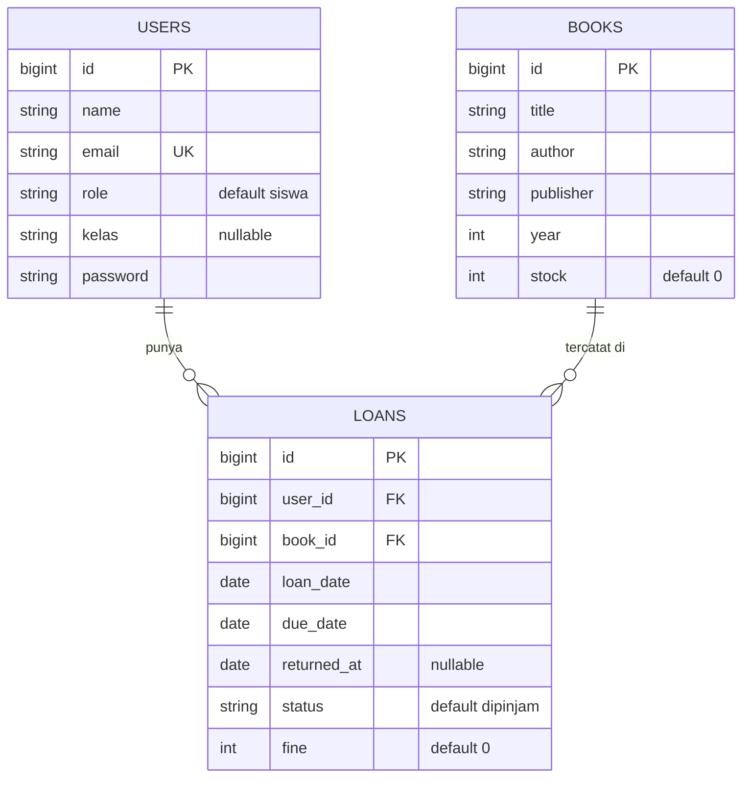

# UKK 2026 - Aplikasi Peminjaman Buku

Aplikasi pencatatan peminjaman buku untuk perpustakaan sekolah. Backend-nya Laravel, sedangkan halaman kelola datanya memakai Filament 4.

Dikerjakan oleh **Andi Alfatih Ghaisan Aththobarani** sebagai proyek Uji Kompetensi Keahlian (UKK) 2026.

---

## Ringkasan

Aplikasi ini menyimpan tiga hal: daftar buku, daftar pengguna, dan catatan siapa meminjam buku apa. Semua dikelola lewat panel admin Filament yang bisa dibuka di `/admin`.

Pengguna punya kolom `role` dengan nilai bawaan `siswa`. Kalau perannya `admin`, fungsi `isAdmin()` di model `User` akan mengembalikan `true`. Siswa juga punya kolom `kelas` yang boleh dikosongkan.

Setiap peminjaman mencatat siapa peminjamnya, buku apa, tanggal pinjam, batas kembali, tanggal kembali (kosong selama buku belum dikembalikan), status (bawaan `dipinjam`), dan denda (bawaan 0).

## Struktur Proyek yang Saya Buat

Selain bawaan Laravel, bagian yang saya kerjakan ada di sini:

```
app/
  Models/
    Book.php
    Loan.php
    User.php
  Filament/Resources/
    Books/    -> BookResource, halaman (List, Create, Edit), BookForm, BooksTable
    Loans/    -> LoanResource, halaman (List, Create, Edit), LoanForm, LoansTable
    Users/    -> UserResource, halaman (List, Create, Edit), UserForm, UsersTable
database/
  migrations/
    ..._create_books_table.php
    ..._create_loans_table.php
  peminjaman_buku.sql
```

Tabel `users` dibuat oleh migration bawaan Laravel yang saya tambah dengan kolom `role` dan `kelas`.

## Skema Database

### Tabel `books`

| Kolom | Tipe | Catatan |
|-------|------|---------|
| id | bigint | kunci utama |
| title | string | judul buku |
| author | string | penulis |
| publisher | string | penerbit |
| year | integer | tahun terbit |
| stock | integer | bawaan 0 |

### Tabel `loans`

| Kolom | Tipe | Catatan |
|-------|------|---------|
| id | bigint | kunci utama |
| user_id | bigint | foreign key ke `users`, hapus berantai |
| book_id | bigint | foreign key ke `books`, hapus berantai |
| loan_date | date | tanggal pinjam |
| due_date | date | batas pengembalian |
| returned_at | date | boleh kosong |
| status | string | bawaan `dipinjam` |
| fine | integer | bawaan 0 |

### Tabel `users` (kolom tambahan)

| Kolom | Tipe | Catatan |
|-------|------|---------|
| role | string | bawaan `siswa` |
| kelas | string | boleh kosong |

Karena foreign key memakai `cascadeOnDelete()`, menghapus seorang pengguna atau sebuah buku juga akan menghapus riwayat peminjaman yang terkait dengannya.

### Diagram Relasi



## Model

**Book** (`app/Models/Book.php`)
- `$fillable`: `title`, `author`, `publisher`, `year`, `stock`.

**Loan** (`app/Models/Loan.php`)
- `$fillable`: `user_id`, `book_id`, `loan_date`, `due_date`, `returned_at`, `status`, `fine`.
- `$casts`: `loan_date`, `due_date`, dan `returned_at` dibaca sebagai tanggal (date).
- `user()`: relasi `belongsTo` ke `User`, misalnya `$loan->user->name`.
- `book()`: relasi `belongsTo` ke `Book`, misalnya `$loan->book->title`.

**User** (`app/Models/User.php`)
- `$fillable`: `name`, `email`, `password`, `role`, `kelas`.
- `$hidden`: `password` dan `remember_token`.
- `casts()`: `email_verified_at` sebagai datetime dan `password` otomatis di-hash.
- `isAdmin()`: `true` jika `role` bernilai `admin`.

## Panel Admin

Panel Filament memiliki tiga menu kelola data:

| Menu | Resource | Alamat contoh |
|------|----------|---------------|
| Buku | `BookResource` | `/admin/books` |
| Peminjaman | `LoanResource` | `/admin/loans` |
| Pengguna | `UserResource` | `/admin/users` |

### Tabel Buku dan Tombol Pinjam

Tabel buku (`BooksTable`) menampilkan judul, penulis, penerbit, tahun, dan stok. Judul, penulis, dan penerbit bisa dicari lewat kolom pencarian, sedangkan tahun dan stok bisa diurutkan.

Peminjaman dibuat lewat tombol **Pinjam** pada tiap baris buku. Tombol ini hanya muncul untuk pengguna yang bukan admin, dan tidak bisa diklik kalau stok buku 0. Setelah dikonfirmasi, aplikasi:

1. memeriksa jumlah pinjaman aktif milik pengguna; kalau sudah ada 3 buku berstatus `dipinjam`, peminjaman ditolak dengan pesan "Maksimal pinjam 3 buku",
2. membuat data peminjaman dengan `loan_date` hari ini dan `due_date` 7 hari kemudian (status memakai nilai bawaan `dipinjam`),
3. mengurangi `stock` buku sebanyak 1,
4. menampilkan notifikasi "Buku berhasil dipinjam".

### Hak Akses Menu Buku

Pada `BookResource`, admin boleh melakukan semua aksi (lihat, tambah, ubah, hapus). Pengguna lain hanya diizinkan melihat daftar buku, jadi siswa tidak bisa menambah, mengubah, atau menghapus data buku.

### Form Peminjaman

Berkas `LoanForm` mendefinisikan tujuh isian berikut. Namun halaman tambah dan ubah peminjaman saat ini dikunci (lihat bagian Hak Akses Peminjaman di bawah), sehingga form ini belum bisa dibuka lewat menu Loans.

| Isian | Jenis input | Keterangan |
|-------|-------------|------------|
| `user_id` | angka | wajib diisi, berupa ID pengguna |
| `book_id` | angka | wajib diisi, berupa ID buku |
| `loan_date` | pemilih tanggal | wajib diisi |
| `due_date` | pemilih tanggal | wajib diisi |
| `returned_at` | pemilih tanggal | boleh kosong |
| `status` | teks | wajib diisi, isian awal `dipinjam` |
| `fine` | angka | wajib diisi, isian awal 0 |

### Hak Akses Peminjaman

Pengaturan akses menu Loans ada di `LoanResource`:

- **Data yang tampil:** admin (`isAdmin()` bernilai `true`) melihat seluruh peminjaman, sedangkan pengguna lain hanya melihat peminjaman miliknya sendiri (`user_id` sama dengan ID pengguna yang login).
- **Aksi yang diizinkan:** hanya melihat daftar (`viewAny`). Aksi lain seperti tambah dan ubah ditolak, sehingga membuka `/admin/loans/create` menghasilkan halaman **403 Forbidden**.
- Tombol **Kembalikan** adalah aksi khusus di tabel, jadi tetap berfungsi walaupun tambah dan ubah dikunci.

### Hak Akses Menu Pengguna

Pada `UserResource`, semua aksi hanya diizinkan untuk admin. Pengguna dengan peran `siswa` ditolak, sehingga menu pengelolaan anggota hanya bisa dipakai admin.

### Tabel Peminjaman dan Tombol Kembalikan

Tabel peminjaman (`LoansTable`) menampilkan ID pengguna, ID buku, tanggal pinjam, batas kembali, tanggal kembali, status, dan denda. Kolom `created_at` dan `updated_at` tersedia tetapi disembunyikan secara bawaan. Kolom status tampil sebagai lencana berwarna: kuning untuk `dipinjam`, hijau untuk status lainnya.

Setiap baris yang berstatus `dipinjam` punya tombol **Kembalikan**. Setelah dikonfirmasi, tombol ini:

1. mengisi `returned_at` dengan waktu saat ini,
2. mengubah `status` menjadi `dikembalikan`,
3. menghitung denda: jumlah hari keterlambatan dikali Rp1.000 (tanpa keterlambatan, denda 0),
4. menambah `stock` buku yang dikembalikan sebanyak 1,
5. menampilkan notifikasi "Buku sudah dikembalikan".

Setelah tombol dipakai, status berubah dan tombol itu tidak muncul lagi pada baris tersebut.

## Route

File `routes/web.php` hanya berisi satu route buatan sendiri. Halaman admin tidak ditulis di sana karena rutenya didaftarkan otomatis oleh Filament.

| Method | URL | Keterangan |
|--------|-----|------------|
| GET | `/` | Menampilkan view `welcome` (halaman awal bawaan Laravel) |
| GET | `/admin` | Panel admin Filament (didaftarkan otomatis oleh Filament) |

## Menjalankan di Komputer Sendiri

Kebutuhan: PHP, Composer, dan database (MySQL lewat XAMPP atau SQLite).

1. Ambil proyeknya:

   ```bash
   git clone https://github.com/gesannn/UKK-2026-Andi-Alfatih-Ghaisan-Peminjaman-Buku.git
   cd UKK-2026-Andi-Alfatih-Ghaisan-Peminjaman-Buku
   ```

2. Pasang dependency:

   ```bash
   composer install
   ```

3. Siapkan file environment:

   ```bash
   cp .env.example .env
   php artisan key:generate
   ```

4. Atur koneksi database di `.env` sesuai database yang dipakai. Contoh untuk MySQL:

   ```env
   DB_CONNECTION=mysql
   DB_HOST=127.0.0.1
   DB_PORT=3306
   DB_DATABASE=peminjaman_buku
   DB_USERNAME=root
   DB_PASSWORD=
   ```

5. Buat tabel dengan migration. Sebagai alternatif, file `database/peminjaman_buku.sql` bisa diimpor lewat phpMyAdmin.

   ```bash
   php artisan migrate
   ```

6. Buat akun untuk masuk ke panel admin:

   ```bash
   php artisan make:filament-user
   ```

7. Jalankan server, lalu buka `http://127.0.0.1:8000/admin`:

   ```bash
   php artisan serve
   ```

Kalau muncul `ERR_CONNECTION_REFUSED` di browser, artinya server belum berjalan. Jalankan `php artisan serve` dulu.

## Catatan dari Kode Saat Ini

Beberapa hal yang saya catat setelah memeriksa kode sendiri:

- Model `Book` dan `User` belum punya relasi `loans()`, sehingga `$book->loans` dan `$user->loans` belum bisa dipakai. Relasi yang ada baru dari sisi `Loan`.
- Tabel peminjaman menampilkan ID pengguna dan ID buku sebagai angka, bukan nama siswa dan judul buku.
- `LoanForm` memakai kolom angka untuk `user_id` dan `book_id`. Kalau form ini nanti dibuka, pilihan berbentuk dropdown (nama siswa dan judul buku) akan lebih mudah dan mengurangi salah input.
- `status` berupa teks bebas di form maupun di database, jadi rawan salah ketik. Pilihan tetap (dropdown) atau enum akan lebih aman.

## Debugging

Tiga masalah yang saya temui selama menguji aplikasi, penyebabnya, dan cara memperbaikinya.

### 1. Tanggal kembali dan denda tidak tersimpan

**Gejala:** setelah tombol **Kembalikan** diklik, status berubah menjadi `dikembalikan`, tetapi kolom Returned at tetap kosong dan Fine tetap 0.

**Penyebab:** kolom `returned_at` dan `fine` belum ada di `$fillable` pada model `Loan`. Tombol Kembalikan mengisinya lewat `update()`, dan Laravel mengabaikan kolom yang tidak terdaftar di `$fillable`. Akibatnya hanya `status` yang tersimpan.

**Perbaikan:** menambahkan kedua kolom ke `$fillable`, dan menambahkan `returned_at` ke `$casts` supaya dibaca sebagai tanggal.

```php
// app/Models/Loan.php
protected $fillable = ['user_id', 'book_id', 'loan_date', 'due_date', 'returned_at', 'status', 'fine'];

protected $casts = [
    'loan_date'   => 'date',
    'due_date'    => 'date',
    'returned_at' => 'date',
];
```

**Pengujian:** saya membuat peminjaman dengan `loan_date` 10 November 2026 dan `due_date` 14 November 2026, lalu mengembalikannya pada 16 November 2026 (terlambat 2 hari). Hasilnya Returned at terisi 16 November 2026 dan denda tersimpan 2000 (2 hari x Rp1.000).

### 2. Halaman admin loading terus

**Gejala:** `http://127.0.0.1:8000/admin` tidak kunjung terbuka, lalu muncul error `Maximum execution time of 60 seconds exceeded`. Perintah `php artisan optimize:clear` juga gagal pada bagian `cache`.

**Penyebab:** MySQL di XAMPP belum menyala, sehingga Laravel tidak bisa terhubung ke database. Sesi dan cache aplikasi disimpan di database, jadi halaman macet saat membacanya.

**Perbaikan:** menyalakan MySQL lewat XAMPP Control Panel, memastikan nama database sama dengan `DB_DATABASE` di `.env`, lalu menjalankan:

```bash
php artisan optimize:clear
php artisan serve
```

### 3. Halaman tambah peminjaman menampilkan 403 Forbidden

**Gejala:** membuka `/admin/loans/create` menghasilkan halaman 403, dan tombol tambah tidak muncul di menu Loans.

**Penyebab:** ini bukan error, melainkan aturan akses di `LoanResource` yang hanya mengizinkan `viewAny`. Peminjaman memang tidak dibuat dari menu Loans, tetapi lewat tombol **Pinjam** di menu Books.

**Tindakan:** tidak ada perbaikan kode. Untuk menguji denda, data peminjaman terlambat dibuat lewat `php artisan tinker` dengan `Loan::create([...])`.

### Perintah yang Dipakai untuk Melacak Masalah

| Tujuan | Perintah |
|--------|----------|
| Membersihkan cache aplikasi | `php artisan optimize:clear` |
| Mencoba model langsung dan membuat data uji | `php artisan tinker` |
| Melihat daftar route | `php artisan route:list` |
| Melihat pesan error lengkap | buka `storage/logs/laravel.log` |

## Evaluasi

**Yang sudah selesai**
- Rancangan tiga tabel (`users`, `books`, `loans`) dengan relasi one-to-many.
- Migration untuk `books` dan `loans`, serta kolom `role` dan `kelas` di `users`.
- Model `Book`, `Loan`, dan `User`, termasuk relasi `user()` dan `book()` pada `Loan`.
- Panel admin Filament 4 untuk mengelola buku, peminjaman, dan pengguna.
- File `peminjaman_buku.sql` sebagai cadangan struktur database.
- Perbaikan `$fillable` dan `$casts` pada model `Loan` agar `returned_at` dan `fine` tersimpan saat buku dikembalikan.
- Tombol Pinjam pada tabel buku (maksimal 3 pinjaman aktif, jatuh tempo 7 hari, stok berkurang otomatis) dan pencarian buku.
- Pembagian hak akses berdasarkan peran: menu Pengguna hanya untuk admin, siswa hanya bisa melihat daftar buku (tanpa tambah, ubah, hapus), dan siswa hanya melihat peminjamannya sendiri.
- Tombol Kembalikan pada tabel peminjaman yang mengubah status, menghitung denda keterlambatan (Rp1.000 per hari), dan menambah stok buku.

**Kendala**

- Tanggal kembali dan denda tidak tersimpan setelah tombol Kembalikan dipakai, karena `returned_at` dan `fine` belum masuk `$fillable`. Sudah diperbaiki dan diuji (lihat bagian Debugging).
- Halaman admin loading terus karena MySQL di XAMPP belum menyala. Teratasi setelah MySQL dinyalakan.

**Yang masih perlu dikembangkan**
- Menambahkan relasi `loans()` pada `Book` dan `User`.
- Menampilkan nama siswa dan judul buku di tabel peminjaman, serta mengganti isian ID di form dengan pilihan dropdown.

## Lisensi

Proyek ini memakai lisensi [MIT](https://opensource.org/licenses/MIT).
